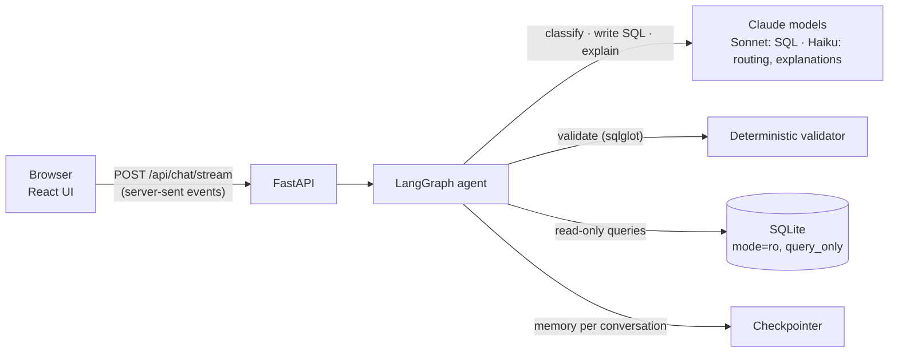
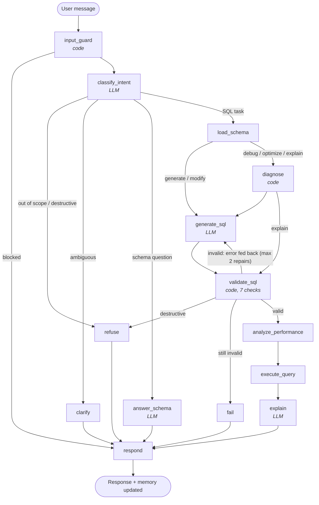

# QueryPilot — SQL Query AI Agent

Ask a database question in plain English and get back **validated, read-only SQL**, a plain-English explanation, and the actual results. Paste SQL to have it **explained, debugged or optimised**. **Bring your own database** by uploading a `.sql` schema or a SQLite file. Anything that isn't about SQL or the database is politely refused.

**Live app:** https://querypilot-sql-agent.onrender.com · **Demo video:** _VIDEO_URL_

Built with **LangGraph**, FastAPI, SQLite, `sqlglot` and React, on Anthropic Claude models.

> The free hosting tier sleeps when idle, so the **first load can take up to a minute**. After that it's fast. No login is needed.

---

## What it does

| Brief requirement | How QueryPilot handles it |
| --- | --- |
| Natural language → SQL | A LangGraph workflow writes SQLite SQL against the live schema, then validates and runs it |
| SQL validation | Seven deterministic checks on every query: parses, single statement, read-only, tables exist, columns exist, joins valid, SQLite compiles it |
| Never destructive | Blocked at three layers: the prompt, a syntax-tree check, and a database connection that is physically read-only |
| SQL explanation | A plain-English summary, a step-by-step walk-through, a one-line headline of the result, and any assumptions made |
| SQL optimisation | Rewrites pasted SQL for readability and speed, using SQLite's query plan to recommend specific indexes |
| SQL debugging | Runs the validator on pasted SQL first, so the model receives the concrete errors, then returns a corrected query and lists what was wrong |
| Conversation context | Follow-ups ("only those from California") modify the previous query, using LangGraph's checkpointer memory |
| Out-of-scope handling | Classified and refused with the exact wording from the brief |
| Ambiguity | Asks one clarifying question when no reasonable interpretation exists; otherwise states its assumptions |
| "A sample database schema will be provided" | **Upload any schema in the app** (`.sql` script or SQLite file) and the agent, validator and guardrails switch to it. See [Test with your own database](#test-with-your-own-database) |

**Bonus features implemented:** query execution · follow-up support · query cost estimate (from the query plan) · SQL syntax highlighting · PostgreSQL and MySQL versions of every query (translated with `sqlglot`) · CSV export · SQL download · prompt-injection protection · streaming progress (one event per graph step) · dark mode · Docker deployment · unit, integration and evaluation tests.

---

## Results

| Suite | Result | What it measures |
| --- | --- | --- |
| Evaluation set (real model) | **40 / 40** | Execution accuracy against hand-written gold SQL, plus guardrail behaviour, across 10 categories |
| Unit and integration tests | **76 / 76** | Validator, guards, graph routing, repair loop, memory, API, database uploads — with a scripted fake LLM, no network |

The full eval report is in [`backend/evals/results/latest.md`](backend/evals/results/latest.md). **Caveat:** the eval set was written by me for a schema I designed, so it's a strong signal, not proof of general accuracy. See [Limitations](#limitations).

### What testing on the real model caught

The first full eval run scored 38/40. Every finding was traced to a root cause and fixed in the right place:

| Finding | Root cause | Fix |
| --- | --- | --- |
| Every request failed on first contact | Current Claude models reject the `temperature` parameter | Removed it; consistency comes from structured outputs, strict prompts and the validator |
| "Show all customers" reported 200 customers; there are 300 | The explainer saw only the 200-row display cap | The backend now counts the true total, so summaries can't confuse the cap with the answer |
| "Hired after January 2024" read as from 1 February | Ambiguous phrasing | Prompt rule matching the brief's own example (on or after 1 January) |
| "Which rep handled the most delivered orders?" returned a top-10 list | Two reps are tied; the "default LIMIT 10" rule over-applied | Singular superlatives return only the winners, ties included; tie-aware tests |
| Monthly revenue marked as failing | **The test was wrong:** month labels "2025-01" vs "01", same revenue | Test now compares the revenue per month |

---

## Architecture



The agent is a LangGraph state machine. **Four nodes call the LLM; everything that decides safety or correctness is plain code.**



Details: [`docs/architecture.md`](docs/architecture.md) (components and design decisions) · [`docs/workflow.md`](docs/workflow.md) (every node, state and routing rule, plus the diagram exported from the code) · [`docs/prompts.md`](docs/prompts.md) (every prompt and why it's written that way).

### Key design decisions

1. **The LLM proposes, code decides.** Validation, read-only enforcement and refusals of pasted destructive SQL are deterministic and unit-tested, so they hold even if the model is wrong or manipulated.
2. **Self-correction loop.** When validation fails, the exact error ("Column 'Salary' exists in Employees, not Customers") goes back to the model, up to two times, then the agent stops and says why.
3. **Schema read from the database, plus a small semantic layer.** Columns, keys and allowed values are introspected live; a few notes add business meaning, for example that revenue excludes cancelled and returned orders.
4. **Two model sizes.** A strong model writes SQL; a fast, cheaper model classifies and explains.
5. **Structured outputs everywhere.** Every LLM call returns a typed object, so the graph routes on fields, never on parsing prose.

---

## Run it locally

Requirements: Python 3.11+, Node 18+, an Anthropic API key.

```bash
git clone https://github.com/Garvit2003/querypilot-sql-agent.git
cd querypilot-sql-agent

# Backend
python -m venv .venv && source .venv/bin/activate      # Windows: .venv\Scripts\activate
pip install -r backend/requirements-dev.txt
export ANTHROPIC_API_KEY=your-key                      # Windows: set ANTHROPIC_API_KEY=your-key
cd backend && uvicorn app.main:app --reload --port 8000

# Frontend (new terminal)
cd frontend && npm install && npm run dev               # opens http://localhost:5173
```

The sample database is created automatically on first start (`backend/data/querypilot.db`). To rebuild it: `python -m app.seed`.

**With Docker:**

```bash
docker build -t querypilot .
docker run -p 8000:8000 -e ANTHROPIC_API_KEY=your-key querypilot   # http://localhost:8000
```

**Tests and evals** (from `backend/`):

```bash
pytest                                  # 76 tests, no API key needed
python -m evals.run_evals --workers 4   # 40 cases on the real model, writes evals/results/latest.md
```

### Configuration

| Variable | Default | Purpose |
| --- | --- | --- |
| `ANTHROPIC_API_KEY` | — | Required |
| `QP_LLM_MODEL` | `claude-sonnet-5-5` | Model that writes SQL |
| `QP_LLM_FAST_MODEL` | `claude-haiku-5-5` | Model for routing and explanations |
| `QP_MAX_SQL_ATTEMPTS` | `3` | First try + repairs |
| `QP_RESULT_ROW_LIMIT` | `200` | Rows returned to the UI |
| `QP_RATE_LIMIT_REQUESTS` | `40` | Messages per visitor per window (10 min) |

---

## Sample database

A small company: `Departments`, `Employees` (with a self-referencing manager), `Customers`, `Products`, `Orders`, `OrderItems` — about 5,600 rows of deterministic fake data (fixed random seed, so every build is identical). Full definition: [`backend/app/schema.sql`](backend/app/schema.sql); field meanings: [`docs/schema.md`](docs/schema.md).

## Test with your own database

The brief says a schema will be provided, so the live app accepts one directly:

1. Click the **database chip** at the top right of the chat (it reads "Sample company database") and choose **Change**.
2. **Upload a `.sql` file** (CREATE TABLE statements, optionally with INSERTs) or a **SQLite file** (`.db`, `.sqlite`), or paste the SQL.
3. A new conversation starts on that database. Its tables and starter questions appear on the welcome screen.

Try it with [`examples/library.sql`](examples/library.sql): *"Which author has written the most books?"* → *"Only Indian authors"*.

How it works: a SQL script is executed into a fresh, isolated SQLite file (ATTACH is blocked, 15-second and 2 MB limits); a SQLite file is integrity-checked. Each upload gets an id that conversations pass with every message, and the schema, validator, analyzer and execution all switch to that database. Queries still run on a **read-only** connection. Scripts written for MySQL or PostgreSQL may need small changes for SQLite (for example `AUTO_INCREMENT`). Uploads are kept for a day, and on the free host they're cleared when the server restarts.

Running locally, you can also point the app at any SQLite file: `QP_DB_PATH=/path/to/your.db`.

## Try these

- `Show all employees hired after January 2024`
- `Show all customers` → `Only those from California`
- `Top 5 customers by total revenue`
- `Fix this query: SELECT Name, COUNT(*) FROM Customers GROUP State`
- `Optimize this: SELECT * FROM Orders WHERE strftime('%Y', OrderDate) = '2025'`
- `Delete all cancelled orders` (refused)
- `Who won the FIFA World Cup?` (refused)
- `List customer phone numbers` (explains the data doesn't exist)

---

## Assumptions

- **No schema was attached to the brief,** so I designed one that matches the brief's own examples (employees with hire dates, customers by state). The agent reads whatever SQLite database it's pointed at, so a provided schema can be swapped in via `QP_DB_PATH`.
- **SQLite is the execution database.** PostgreSQL and MySQL versions are translations for display; only the SQLite query is validated and run.
- **Revenue** excludes cancelled and returned orders unless the user asks otherwise (defined once in the schema notes).
- **"After January 2024"** means on or after 1 January 2024, matching the brief's example.
- **A non-foreign-key join is a warning, not an error,** because some legitimate queries join on non-key columns.
- Results are capped at 200 rows and 5 seconds per query to protect the shared deployment.
- The business "schema notes" (for example, revenue excludes cancelled orders) exist for the sample database only; uploaded databases rely on their own table and column names.

## Limitations

- **Agent memory is in-process.** A server restart clears conversation memory (the browser keeps the visible history). Production would use a database-backed LangGraph checkpointer (Postgres or Redis): a one-line change.
- **Eval coverage.** 40 cases on one modest schema. Next steps: grow the set from real user questions, test on a large and messy schema, and add LLM-as-judge scoring for explanation quality.
- **Large schemas.** The whole schema goes into the prompt, which is fine for 6 tables. Hundreds of tables would need retrieval of only the relevant tables first.
- **Free hosting** sleeps when idle (slow first load) and the in-memory rate limit resets on restart.

## Project structure

```
backend/
  app/
    graph.py       LangGraph workflow: state, nodes, routing
    prompts.py     every prompt
    llm.py         model client and structured output schemas
    validator.py   the seven deterministic SQL checks
    guards.py      input checks before any LLM call
    analyzer.py    performance hints and cost estimate from the query plan
    db.py          read-only connections, schema introspection, execution
    databases.py   bring-your-own-database uploads (.sql scripts and SQLite files)
    main.py        FastAPI app (API + serves the built frontend)
    schema.sql, seed.py
  tests/           76 unit and integration tests (fake LLM)
  evals/           40-case evaluation set and runner
frontend/src/      React app (chat, live step trail, query panel)
docs/              architecture, workflow, prompts, schema
examples/          library.sql, a schema to try the upload feature with
Dockerfile, render.yaml
```

## How this was built

Built with AI coding assistance (Claude), which UnifyApps confirmed is permitted for this assignment. The product and design decisions, the guardrail approach and the evaluation method are documented above and in `docs/`.
