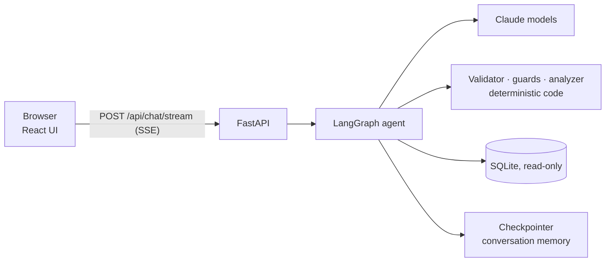

# Architecture

## System

One Docker container runs FastAPI, which serves both the API and the built React app. There's one deploy and one URL, with no cross-origin setup.

| Component | File | Responsibility |
| --- | --- | --- |
| React UI | `frontend/src/` | Chat, live step trail, query panel (SQL / Explanation / Results / Checks), history in localStorage, dark mode |
| API | `backend/app/main.py` | `/api/chat`, `/api/chat/stream`, `/api/schema`, `/api/databases` (upload), `/api/health`; rate limiting; friendly error mapping; serves the frontend |
| Agent | `backend/app/graph.py` | LangGraph state machine (see `workflow.md`) |
| Prompts | `backend/app/prompts.py` | All prompts (see `prompts.md`) |
| LLM client | `backend/app/llm.py` | Provider-agnostic interface; structured output schemas; injectable for tests |
| Input guards | `backend/app/guards.py` | Blocks pasted destructive SQL, prompt injection, empty or over-long input before any LLM call |
| Validator | `backend/app/validator.py` | Seven checks on a sqlglot syntax tree plus SQLite `EXPLAIN` |
| Analyzer | `backend/app/analyzer.py` | Index recommendations, non-sargable filters, unused joins, `SELECT *`, cost estimate from `EXPLAIN QUERY PLAN` |
| Database | `backend/app/db.py` | Read-only connections, schema introspection (cached per database file), schema notes, execution with row and time limits |
| Uploads | `backend/app/databases.py` | Bring-your-own-database: runs a `.sql` script into an isolated SQLite file (ATTACH blocked, size and time limits) or stores a checked SQLite file; resolves upload ids to files |

## Which database a turn uses

Every chat request may carry a `db_id`. The graph resolves it once per node via `databases.path_for()`, and the schema, validator, analyzer and executor all receive that path. With no `db_id`, the sample database is used. Business notes apply only to the sample database.

## Defence in depth for "never destructive"

| Layer | Mechanism | Holds even if… |
| --- | --- | --- |
| 1. Input guard | Regex for SQL write/DDL syntax and injection phrasing, before any LLM call | — |
| 2. Classifier | LLM labels natural-language write requests as `destructive` → refused | the guard missed a paraphrase |
| 3. Prompt | SQL prompt allows only SELECT / WITH … SELECT | — |
| 4. Validator | Rejects any non-SELECT root and any write/DDL node anywhere in the syntax tree, and stacked statements | the model was tricked into writing a DELETE |
| 5. Database | `mode=ro` file open plus `PRAGMA query_only = ON` | a future bug skipped the validator |

Layers 4 and 5 are deterministic and tested (`tests/test_validator.py`, `tests/test_graph.py::test_model_tricked_into_destructive_sql_is_still_blocked`).

## Why these choices

- **LangGraph over a single prompt:** a single prompt can't validate-and-retry, and its internal decisions can't be tested. A graph gives fixed, auditable paths with a loop only where intended.
- **LangGraph over a free-roaming ReAct agent:** a tool that touches data should be predictable. The agent can only move along edges we drew.
- **sqlglot over regex:** checks structure, not text. It resolves columns through aliases, sub-queries and CTEs, and finds a DELETE hidden inside a CTE. It also translates to other dialects.
- **SQLite:** zero setup, ships in the container, true read-only mode. Moving to Postgres means changing the driver and the sqlglot dialect.
- **Two model sizes:** accuracy where it matters (SQL), speed and cost everywhere else.
- **Server-sent events:** answers take 4–10 s. Streaming each finished graph step shows progress and makes the agent's design visible to the user.

## Production next steps

Database-backed checkpointer (Postgres/Redis) · authentication and per-user rate limits in Redis · schema retrieval for large databases · query result caching · tracing (LangSmith or OpenTelemetry) · an eval suite run in CI on every prompt change.
