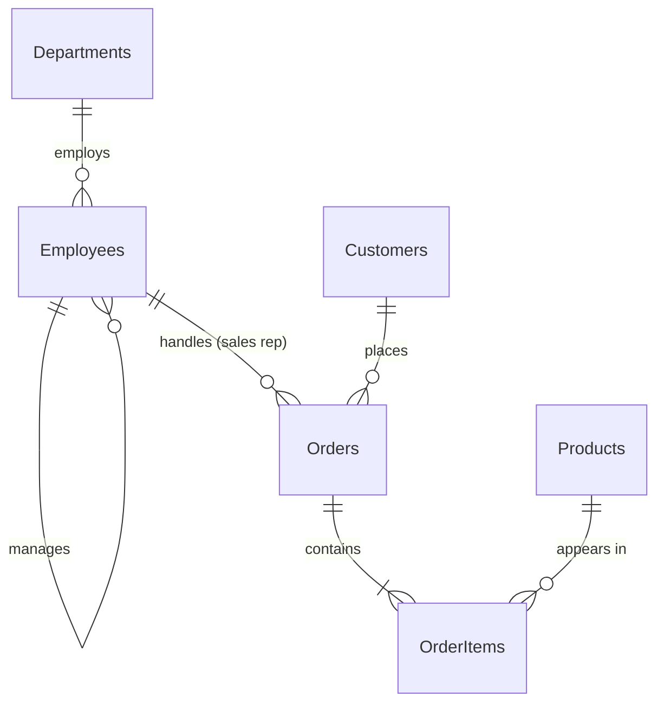

# Sample database schema

SQLite. Definition: [`backend/app/schema.sql`](../backend/app/schema.sql). Data: [`backend/app/seed.py`](../backend/app/seed.py) (fixed seed, identical on every build). To test your own schema instead, upload it in the app (see the README).

## Departments (7 rows)

One row per department.

| Column | Type | Key | Values |
| --- | --- | --- | --- |
| DepartmentID | INTEGER | PK |  |
| DepartmentName | TEXT |  | Customer Support, Engineering, Finance, Human Resources, Marketing, Operations, Sales |
| Location | TEXT |  | Austin, Chicago, New York, Phoenix, San Francisco, Seattle |
| Budget | REAL |  |  |

Indexed: DepartmentName

## Employees (68 rows)

ManagerID points to another employee (self-join); department heads have ManagerID NULL. HireDate is 'YYYY-MM-DD' text.

| Column | Type | Key | Values |
| --- | --- | --- | --- |
| EmployeeID | INTEGER | PK |  |
| FirstName | TEXT |  |  |
| LastName | TEXT |  |  |
| Email | TEXT |  |  |
| JobTitle | TEXT |  |  |
| DepartmentID | INTEGER | FK → Departments.DepartmentID |  |
| ManagerID | INTEGER | FK → Employees.EmployeeID |  |
| HireDate | TEXT |  |  |
| Salary | REAL |  |  |

Indexed: DepartmentID; Email

## Customers (300 rows)

State holds the full US state name (e.g. 'California', not 'CA'). SignupDate is 'YYYY-MM-DD' text.

| Column | Type | Key | Values |
| --- | --- | --- | --- |
| CustomerID | INTEGER | PK |  |
| FirstName | TEXT |  |  |
| LastName | TEXT |  |  |
| Email | TEXT |  |  |
| City | TEXT |  |  |
| State | TEXT |  | Arizona, California, Colorado, Florida, Georgia, Illinois, Massachusetts, New York, Texas, Washington |
| Country | TEXT |  | USA |
| Segment | TEXT |  | Consumer, Corporate, Small Business |
| SignupDate | TEXT |  |  |

Indexed: Email

## Products (32 rows)

IsActive is 1 for products currently sold, 0 for discontinued.

| Column | Type | Key | Values |
| --- | --- | --- | --- |
| ProductID | INTEGER | PK |  |
| ProductName | TEXT |  |  |
| Category | TEXT |  | Accessories, Electronics, Furniture, Office Supplies, Software |
| UnitPrice | REAL |  |  |
| StockQuantity | INTEGER |  |  |
| IsActive | INTEGER |  |  |

Indexed: ProductName

## Orders (1,500 rows)

EmployeeID is the sales rep who handled the order; NULL means a self-serve online order. OrderDate is 'YYYY-MM-DD' text. TotalAmount is the order value after discounts. For revenue, exclude Status 'Cancelled' and 'Returned' unless the user asks otherwise.

| Column | Type | Key | Values |
| --- | --- | --- | --- |
| OrderID | INTEGER | PK |  |
| CustomerID | INTEGER | FK → Customers.CustomerID |  |
| EmployeeID | INTEGER | FK → Employees.EmployeeID |  |
| OrderDate | TEXT |  |  |
| Status | TEXT |  | Cancelled, Delivered, Pending, Returned, Shipped |
| TotalAmount | REAL |  |  |

Indexed: OrderDate; CustomerID

## OrderItems (3,734 rows)

Line items of an order. Line value = Quantity * UnitPrice * (1 - Discount). Discount is a fraction (0.1 = 10%).

| Column | Type | Key | Values |
| --- | --- | --- | --- |
| OrderItemID | INTEGER | PK |  |
| OrderID | INTEGER | FK → Orders.OrderID |  |
| ProductID | INTEGER | FK → Products.ProductID |  |
| Quantity | INTEGER |  |  |
| UnitPrice | REAL |  |  |
| Discount | REAL |  |  |

Indexed: ProductID; OrderID
