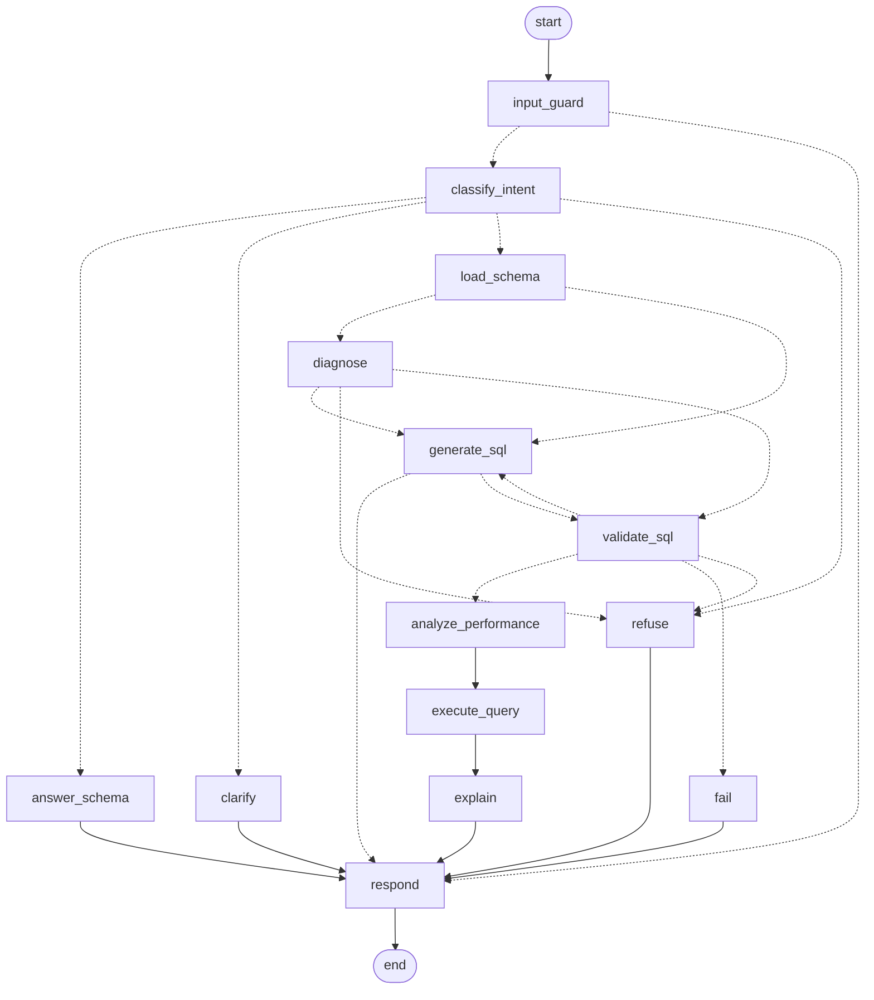

# LangGraph workflow

## State

One `AgentState` dictionary flows through every node (`backend/app/graph.py`).

| Field | Scope | Meaning |
| --- | --- | --- |
| `messages` | persisted (appended each turn) | Conversation history used in prompts |
| `last_sql` | persisted | The last valid query; follow-ups build on it |
| `user_input`, `intent`, `user_sql` | per turn | The message, its classified intent, any SQL the user pasted |
| `candidate_sql`, `attempts`, `validation`, `validation_history` | per turn | The repair loop's working state |
| `final_sql`, `performance`, `cost`, `results`, `explanation` | per turn | What the UI shows |
| `response_type` | per turn | `sql` · `refusal` · `clarification` · `answer` · `error` |
| `steps` | per turn | Nodes visited, streamed to the UI |

Per-turn fields are reset by `TURN_RESET` at the start of every message. Persisted fields live in the checkpointer under the conversation's `thread_id`.

## Nodes

| Node | LLM? | What it does |
| --- | --- | --- |
| `input_guard` | no | Blocks empty or over-long input, pasted destructive SQL, prompt-injection phrasing |
| `classify_intent` | fast | One of: generate, modify, optimize, debug, explain, schema_info, destructive, ambiguous, out_of_scope. Code then corrects facts the model can't know: modify with no previous query → generate; "explain that query" → uses `last_sql` |
| `refuse` | no | Fixed refusal text per reason |
| `clarify` | no | Returns the clarifying question |
| `answer_schema` | fast | Answers questions about tables and columns from the schema only |
| `load_schema` | no | Live schema plus semantic notes into the prompt |
| `diagnose` | no | For pasted SQL: runs validator and analyzer so the model gets concrete findings. Broken SQL asked to be "explained" is re-routed to debug |
| `generate_sql` | strong | Five task modes: generate, modify, debug, optimize, repair. Returns SQL, assumptions, notes, or a "can't answer" message |
| `validate_sql` | no | Seven checks (see `architecture.md`) |
| `analyze_performance` | no | Index recommendations and cost estimate from SQLite's query plan |
| `execute_query` | no | Read-only connection, 200-row cap, 5-second timeout, true total count |
| `explain` | fast | Summary, steps, result headline (sees the results) |
| `fail` | no | Honest message after 3 invalid attempts |
| `respond` | no | Builds the reply, appends to memory, stores `last_sql`, adds PostgreSQL/MySQL translations |

## Routing rules

| After | Condition | Next |
| --- | --- | --- |
| `input_guard` | blocked | `respond` |
| `classify_intent` | out_of_scope or destructive | `refuse` |
| | ambiguous | `clarify` |
| | schema_info | `answer_schema` |
| | otherwise | `load_schema` |
| `load_schema` | generate or modify | `generate_sql` |
| | debug, optimize, explain | `diagnose` |
| `diagnose` | pasted SQL is destructive | `refuse` |
| | explain and SQL is valid | `validate_sql` (skips generation) |
| | otherwise | `generate_sql` |
| `generate_sql` | model returned no SQL (data doesn't exist) | `respond` as clarification |
| `validate_sql` | valid | `analyze_performance` → `execute_query` → `explain` → `respond` |
| | destructive | `refuse` |
| | invalid and attempts < 3 | `generate_sql` (repair, with the errors) |
| | invalid after 3 attempts | `fail` |

## Diagram exported from the code

Generated with `build_graph().get_graph().draw_mermaid()`. Dotted lines are conditional edges.

## Example traces

| Request | Path |
| --- | --- |
| "Show all employees hired after January 2024" | input_guard → classify_intent → load_schema → generate_sql → validate_sql → analyze_performance → execute_query → explain → respond |
| "Only those from California" (follow-up) | same path; `generate_sql` runs in *modify* mode with `last_sql` |
| A made-up column on the first draft | … → generate_sql → validate_sql ✗ → generate_sql (repair) → validate_sql ✓ → … |
| "Who won the FIFA World Cup?" | input_guard → classify_intent → refuse → respond |
| "DROP TABLE Customers" | input_guard → respond (no LLM call) |
